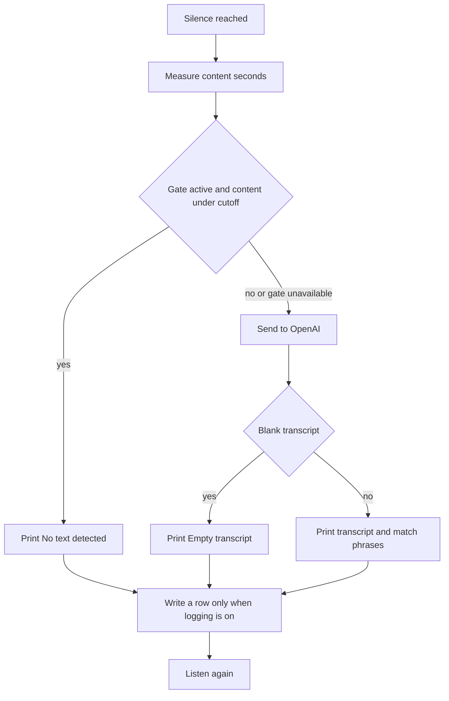

# Short-clip gate before transcription

## Advice

Measure **content length**: audio written after `voice started`, minus the trailing quiet that just ended the phrase. That trailing quiet is about 2.0 s and it is already inside the array that would be sent (`recorder.write` runs on every hop, including silence). The lead-in (`preroll_s` 1.5 s) is inside that array too. A bang is therefore about 3.5 s of audio and about 0 s of content. A 1 s check on the raw array would never discard anything.

Starting cutoff: **1.0 s**, strict less-than, in the new module. Exactly 1.0 s is sent. The first ~0.1 s that armed the detector sits in the lead-in and is not counted, so the number is slightly shorter than the spoken length. If a real sentence is discarded, lower `min_content_s`. If bangs are still sent, raise it.

Fallback for the **gate** only: a missing module, `gate_enabled = False`, or a bad length sends the clip to OpenAI and keeps listening. One `WARNING` goes to stderr when the module is missing. Turning the gate off on purpose prints no warning.

The silence wait stays as it is. The check runs only after `[n] silence`, immediately before the API call.

## Two switches

These are independent. Turning off logging does not turn off the gate.

- `gate_enabled = True` in [src/occurrences/config.py](src/occurrences/config.py). This is the short-clip check and the empty-transcript line. `False` restores today's transcribe path.
- `log_enabled = True` in the same file. This is the whole SQLite feature. `False` means the listener never imports `sqlite3`, never opens a database, and never builds a row. The length check and the screen lines still run. Use this once the cutoff is settled.

A database that cannot be opened prints one stderr `WARNING`, skips writing for the rest of the run, and leaves the gate running. It does not discard the enhancement and it does not crash.

## What you will see

Unchanged status lines, then one result line. These lines print whether or not logging is on:

- Short clip, no API call: `[1] No text detected`
- API returned blank or whitespace: `[1] Empty transcript`
- API returned text: `[1] <text>`, then phrase matches as today

Phrase matching runs only for non-empty text. API exceptions still print and return. With logging off, an exception still adds no row because nothing is written at all.

## New package

Gate logic and the optional log live in [src/occurrences](src/occurrences). The log code sits in its own file and is loaded only when `log_enabled` is `True`. Nothing is added to [src/record](src/record), [src/transcribe](src/transcribe), or [src/phrase_match](src/phrase_match). [src/vad/settings.py](src/vad/settings.py) stays as it is.

[src/vad/__main__.py](src/vad/__main__.py) is the only existing code that changes, because that loop is what decides to call OpenAI. It will:

- Count samples written after `recorder.start()` and, at silence, set `content_s` to that time minus the trailing quiet just accumulated. This counter is the gate measurement. It stays while the gate is on.
- Take `captured_s` from the finished array only when a row will actually be written.
- Call `finish()` before returning so the recorder is reset, including on a short clip.
- Import the new package inside `try`. On failure, print one stderr `WARNING` and keep the current transcribe path.

Package contents:

- [src/occurrences/config.py](src/occurrences/config.py): `gate_enabled = True`, `log_enabled = True`, `min_content_s = 1.0`.
- A pure check with no database code: discard only when `content_s` is a real number and `content_s < min_content_s`. `None`, NaN, or a negative value does not discard.
- [src/occurrences/store.py](src/occurrences/store.py), used only while logging is on. SQLite file `src/occurrences/occurrences.sqlite`, path taken from the module file so the working directory does not matter. Add that file to [.gitignore](.gitignore). `sqlite3` is enough; no new dependency.
- While both switches are on, every finished clip gets a row: time, utterance number, `content_s`, `captured_s`, the cutoff used, and reason `short`, `empty`, or `sent`. No transcript text and no audio. Insert errors print a stderr `WARNING` and do not change the decision already made.
- While the gate is bypassed, nothing is written even if `log_enabled` is `True`.

## Reading the log

`python -m occurrences` prints percentages over the **whole** table, then the latest 20 rows. Fails are `short` plus `empty`, shown separately and as one total. It only reads an existing file. With logging off, or with no file yet, it prints that there is no log and exits. The listener never runs this command.

## User manual

Write the manual as [src/occurrences/README.md](src/occurrences/README.md). It is the user-facing page for this feature: both switches, the 1.0 s cutoff and which way to turn it, the two screen lines, the fail-open fallback, and `python -m occurrences`. Same plain style as [docs/users-guide.md](docs/users-guide.md).

In the project [README.md](README.md), add one link to that file. Do not copy the manual into the project README, and do not edit [docs/users-guide.md](docs/users-guide.md).
