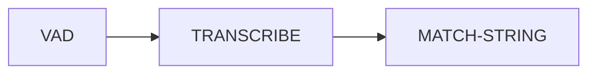

# Voice listener



This program listens on the default microphone, waits until a phrase ends, sends that audio to OpenAI, and prints the transcript. If the transcript contains a phrase you listed, it prints that phrase too.

Nothing is written to disk. The audio stays in memory. Ctrl+C stops the program and does not send a phrase that has not finished.

A new user should follow [docs/users-guide.md](docs/users-guide.md).

## What happens to one phrase

1. The microphone is read at 16 kHz. The first 0.5 seconds measure the room. The terminal prints that level as `Ready. Room level ...`.
2. [`src/vad/voice.py`](src/vad/voice.py) accepts a frame only when it is loud enough and has a speech pitch plus overtones. A clap has no pitch. A beep is a single tone. Both are rejected.
3. [`src/vad/onset.py`](src/vad/onset.py) waits for 5 voiced frames in a row before speech counts as started. The terminal prints `voice started`.
4. [`src/record`](src/record) keeps the 1.5 seconds of audio from before that moment, then keeps capturing until 2 seconds of silence. The loudest sample is scaled to 0.45 so a quiet microphone is still usable. No wav file is written.
5. [`src/transcribe`](src/transcribe) sends that audio to OpenAI `gpt-transcribe` and prints the text. The microphone is not read while the request runs.
6. [`src/phrase_match`](src/phrase_match) looks for the phrases in its config. One hit prints that phrase. Several hits print them as a list. No hit prints nothing else.

The listener then waits for the next phrase.

## Layout

| Path | Role |
| --- | --- |
| [`src/vad`](src/vad) | Microphone loop, voice decision, and onset gate. Run this package. |
| [`src/record`](src/record) | Holds the utterance in memory and scales its level. |
| [`src/transcribe`](src/transcribe) | Builds a wav in memory and calls OpenAI. The API key lives in `src/transcribe/.env`, which is not committed. |
| [`src/phrase_match`](src/phrase_match) | Checks the transcript for listed phrases. |
| [`src/vad1`](src/vad1) | Unused earlier copy. `python -m vad` does not use it. |
| [`src/tone-sound-generator-script`](src/tone-sound-generator-script) | Unused. The listener does not play tones. |

## Requirements

Python 3.12 or newer. The installed packages are listed in [`pyproject.toml`](pyproject.toml):

- `numpy==2.5.5`
- `openai==3.60.0`
- `sounddevice==0.5.6`

From the repository root, with the virtualenv active:

```bash
pip install -e .
python -m vad
```

## Listener settings

These live in [`src/vad/settings.py`](src/vad/settings.py). Change them there and run `python -m vad` again.

Timing:

- `sample_rate` `16000`. Samples per second from the microphone.
- `frame_s` `0.04`. Each decision looks at 40 ms of audio.
- `hop_s` `0.02`. The window steps forward 20 ms at a time.
- `calibration_s` `0.5`. How long the room is measured before listening starts.
- `silence_s` `2.0`. Quiet time that ends the phrase and sends it to OpenAI.

Starting and stopping, used by [`src/vad/onset.py`](src/vad/onset.py):

- `consecutive` `5`. Voiced frames in a row required before `voice started`. That is about 0.1 s once a frame is already accepted as voice.
- `gap_frames` `1`. One quiet frame is allowed inside that run without resetting it.
- `release_consecutive` `6`. Quiet frames required, after a phrase has started, before the gate will arm for another phrase. The recording itself ends on `silence_s`, not on this count.

Loudness:

- `noise_multiplier` `3.0`. The level floor is this many times the measured room level.
- `min_level` `0.0001`. The floor is never lower than this. A printed room level of `0.0001` or `0.0002` means the microphone stream is sitting on that floor.

Speech shape, used by [`src/vad/voice.py`](src/vad/voice.py). These reject loud sounds that are not speech. Leave them alone unless speech is refused or noise is accepted:

- `min_harmonicity` `0.35`. How strong the pitch has to be.
- `pitch_low_hz` `70` and `pitch_high_hz` `400`. The range searched for a pitch.
- `min_f0_hz` `75` and `max_f0_hz` `360`. A pitch outside this range is not speech.
- `min_fund_share` `0.12` and `max_fund_share` `0.95`. How much of the first three partials may sit on the fundamental. A vowel sits in the middle. A pure beep sits at the top.
- `max_peak_ratio` `0.5`. Rejects a spectrum that is one narrow spike.
- `harmonic_band_hz` `45`. Width, in hertz, around each partial.

## Capture settings

These live in [`src/record/config.py`](src/record/config.py). They change the audio that is sent. They do not change when a phrase starts.

- `preroll_s` `1.5`. Seconds of audio kept from before `voice started`.
- `gain` `1.0`. Multiplies every sample.
- `target_peak` `0.45`. When above zero, scales the utterance so its loudest sample equals this. Applied after `gain`.

## Phrase settings

These live in [`src/phrase_match/config.py`](src/phrase_match/config.py).

- `enabled` `True`. Set `False` to stop phrase printing. The transcript is still printed.
- `phrases`. The phrases to find. A single phrase still needs a comma: `("okay go",)`. The current list is `("okay go", "Pamela off,")`.

Matching ignores case, accents, and punctuation. The words must appear next to each other. `Okay, go.` matches `okay go`. `Okay, here we go.` does not, because `here` sits between the words. `cat` does not match `category`.

## Transcription settings

[`src/transcribe/.env`](src/transcribe/.env) holds `OPENAI_API_KEY` and `OPENAI_TRANSCRIBE_LANGUAGE`. Leave the language empty to auto-detect. A set value is sent as the language hint. The model name is `gpt-transcribe` in [`src/transcribe/transcribe.py`](src/transcribe/transcribe.py).
